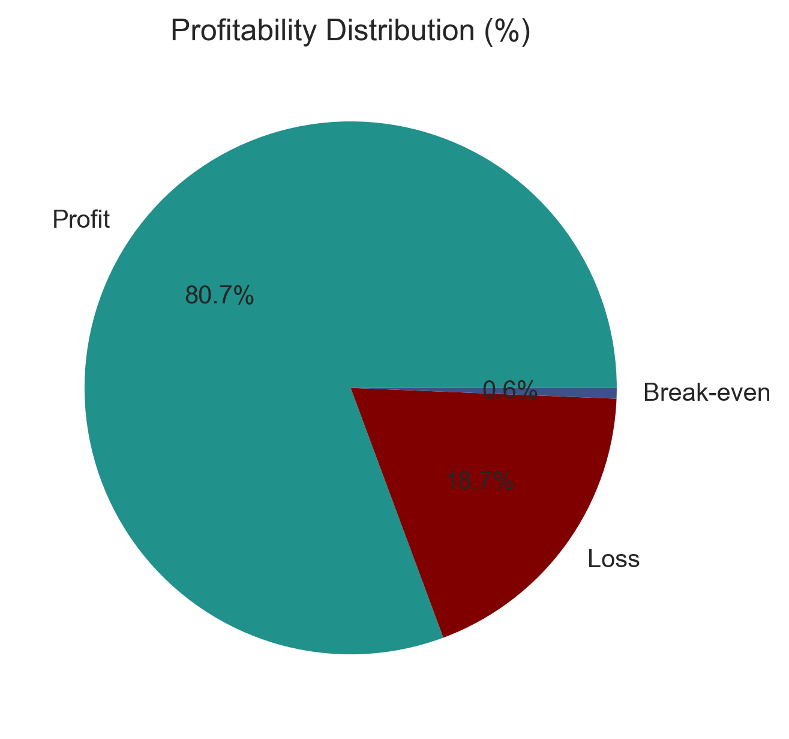
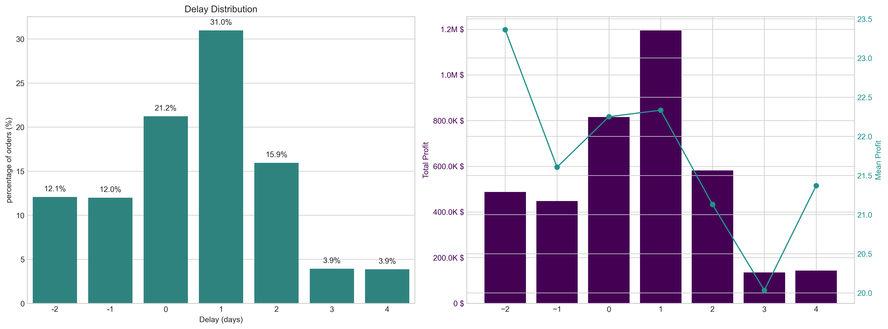
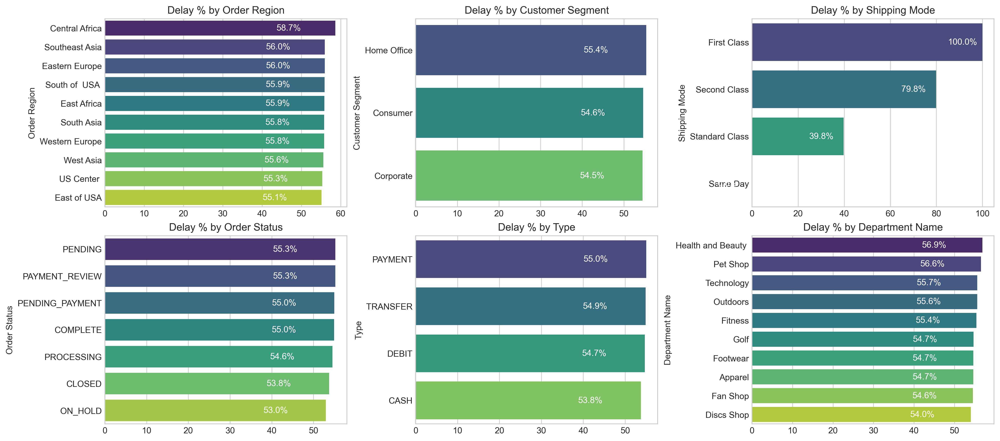
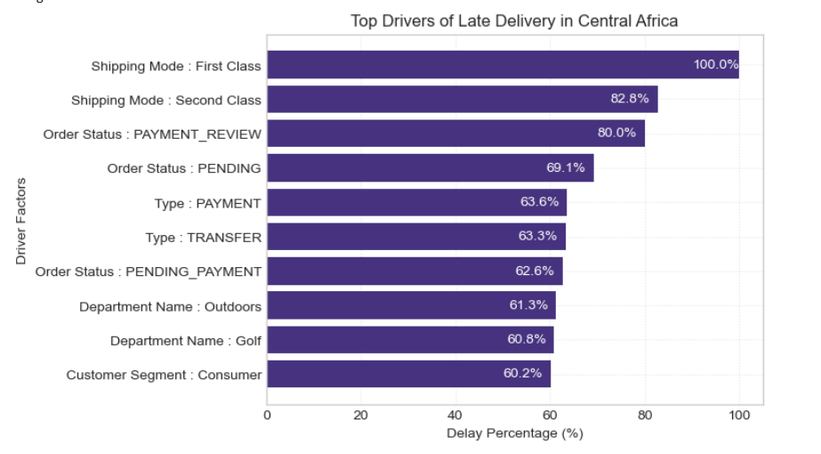
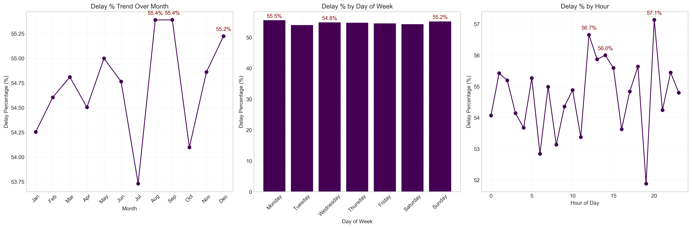

# Supply Chain Delivery Performance & Operational Risk Analysis

**An end-to-end Data Analytics and Machine Learning project analyzing 172K+ e-commerce orders to identify delivery delays, operational bottlenecks, profitability patterns, and delivery risks.**

<p align="center">
  
  
  
  
</p>

---

## Table of Contents

1. [Project Overview](#1-project-overview)
2. [Business Objectives](#2-business-objectives)
3. [Dataset](#3-dataset)
4. [Tools and Technologies](#4-tools-and-technologies)
5. [Project Workflow](#5-project-workflow)
6. [Data Cleaning and Feature Engineering](#6-data-cleaning-and-feature-engineering)
7. [Exploratory Data Analysis and Key Findings](#7-exploratory-data-analysis-and-key-findings)
8. [Data Visualizations](#8-data-visualizations)
9. [Machine Learning](#9-machine-learning)
10. [Business Recommendations](#10-business-recommendations)
11. [Project Structure](#11-project-structure)
12. [How to Run the Project](#12-how-to-run-the-project)
13. [Limitations and Future Improvements](#13-limitations-and-future-improvements)
14. [Author](#14-author)

---

## 1. Project Overview

Late deliveries are a major challenge for e-commerce businesses. They can affect customer satisfaction, delivery reliability, and operational efficiency.

This project analyzes the **DataCo Smart Supply Chain dataset**, containing 172,765 orders from January 2015 to January 2018.

The analysis investigates delivery performance across shipping modes, geographical regions, product departments, order timing, and profitability.

It also includes a machine learning component using Random Forest classification to identify potentially high-risk orders.

**Main Finding:** 54.71% of analyzed orders were delivered later than their scheduled shipping time.

The project combines data analysis, business problem-solving, visualization, and predictive modeling to generate actionable operational insights.

## 2. Business Objectives

The main objectives are to:

- Measure overall delivery performance using business KPIs.
- Identify shipping modes and regions with high late-delivery rates.
- Investigate operational bottlenecks across departments and product categories.
- Understand the relationship between delivery delays and profitability.
- Identify seasonal and time-based delivery patterns.
- Develop a machine learning model to predict delivery risk.
- Provide data-driven recommendations to improve delivery operations.

### Key Business Questions

1. What percentage of orders are delivered late?
2. Which shipping modes experience the highest delay rates?
3. Which geographical regions have the worst delivery performance?
4. How do departments and product categories contribute to operational bottlenecks?
5. How are delivery delays related to order profitability?
6. Do order month, day, and hour influence delivery patterns?
7. Which features are most important for predicting delivery risk?

## 3. Dataset

**Dataset:** DataCo Smart Supply Chain

**Source:** [DataCo Smart Supply Chain Dataset – Kaggle](https://www.kaggle.com/datasets/shashwatwork/dataco-smart-supply-chain-for-big-data-analysis)

| Dataset Attribute | Details |
|---|---|
| Original records | 180,519 |
| Original columns | 53 |
| Records after cleaning | 172,765 |
| Columns after cleaning | 20 |
| Analysis period | January 2015 – January 2018 |
| Canceled shipments | Removed |
| Duplicate records | None found |

The dataset contains information about customer orders, products, shipping, geographical regions, order status, and profitability.

## 4. Tools and Technologies

| Category | Tools |
|---|---|
| Programming Language | Python |
| Data Manipulation | Pandas, NumPy |
| Data Visualization | Matplotlib, Seaborn |
| Machine Learning | Scikit-Learn |
| Classification Algorithm | Random Forest |
| Class Imbalance Handling | Imbalanced-Learn, SMOTE |
| Data Encoding | Frequency Encoding |
| Development Environment | Jupyter Notebook |
| Version Control | Git, GitHub |

## 5. Project Workflow

The project follows an end-to-end analytical process:

1. **Business Understanding:** Defined the delivery performance problem and analytical objectives.
2. **Data Collection:** Obtained the DataCo Smart Supply Chain dataset.
3. **Data Cleaning:** Removed irrelevant fields and canceled shipments, and checked for duplicate records.
4. **Feature Engineering:** Created delivery delay, processing time, profitability, and time-based features.
5. **Exploratory Data Analysis:** Investigated delivery performance across shipping modes, regions, departments, and time periods.
6. **Operational Bottleneck Analysis:** Identified regions, shipping modes, and product categories with high delay rates.
7. **Profitability Analysis:** Examined profitability patterns and profit associated with delayed orders.
8. **Machine Learning:** Developed and compared multiple Random Forest classification experiments.
9. **Business Recommendations:** Translated analytical findings into recommendations for improving delivery operations.

## 6. Data Cleaning and Feature Engineering

### Data Cleaning

The following preprocessing activities were performed:

- Removed personal information and irrelevant identifier columns.
- Removed empty, constant, and redundant columns.
- Excluded canceled shipments from delivery performance analysis.
- Converted order and shipping dates into datetime format.
- Checked for duplicate records.
- Prepared relevant columns for exploratory analysis and modeling.

### Feature Engineering

Additional features were created to support the analysis.

| Feature | Description |
|---|---|
| Order Processing Time | Actual shipping date minus order date, in days |
| Delay | Actual processing time minus scheduled shipping days |
| Is_Delayed | True when Delay is greater than zero |
| order_month | Month of order placement |
| order_day | Day of the week |
| order_hour | Hour of order placement |
| Profitability Flag | Profit, Loss, or Break-even |

**Important – Delivery Definitions:** The EDA uses the independently calculated `Is_Delayed` column and identifies 54.71% of orders as late. The machine learning model uses the dataset's original `Late_delivery_risk` column, which identifies 57.29% of orders as late-risk. These two definitions are kept separate throughout the project.

## 7. Exploratory Data Analysis and Key Findings

### 7.1 Business KPIs

| KPI | Result |
|---|---:|
| Total Orders | 172,765 |
| Late Deliveries | 94,523 |
| Late Delivery Rate | **54.71%** |
| On-time or Early Delivery Rate | 45.29% |
| Total Positive Order Profit | $7.5M |
| Profit Associated with Delayed Orders | $2.1M |
| 90th Percentile Delay | 3 Days |
| Average Profit per Order | $22.03 |

*Note: The $2.1M represents profit associated with delayed orders, not an actual measured financial loss.*

### 7.2 Shipping Mode Analysis

| Shipping Mode | Late Delivery Rate |
|---|---:|
| First Class | 100.0% |
| Second Class | 79.8% |
| Standard Class | 39.8% |
| Same Day | 0.0% |

**Business Insight:** First Class and Second Class recorded particularly high late-delivery rates. Their delivery commitments and carrier performance require further investigation.

### 7.3 Delivery Delay Distribution

Key findings:

- 31.0% of all orders were delivered exactly one day late.
- 15.9% experienced a two-day delay.
- 3.9% experienced a three-day delay.
- 3.9% experienced a four-day delay.
- The 90th percentile delay among delayed orders was three days.

**Business Insight:** Many delayed orders experienced relatively short delays, indicating opportunities to improve fulfillment and delivery processes.

### 7.4 Profitability Analysis

| Profitability Category | Order Share |
|---|---:|
| Profitable Orders | 80.7% |
| Loss-making Orders | 18.7% |
| Break-even Orders | 0.6% |

Additional observations:

- Delayed orders were associated with approximately $2.1M in profit.
- Mean profit per order remained relatively stable across delay categories, around $20–$23.
- The financial exposure is associated with the volume of delayed orders rather than a dramatic reduction in average profit per delayed order.

**Business Insight:** Improving delivery reliability should go hand in hand with monitoring order profitability.

### 7.5 Regional Analysis

Central Africa recorded the highest late-delivery rate at **58.7%**.

Other leading regions recorded rates between approximately 55.1% and 56.0%.

**Business Insight:** Delivery challenges are present across multiple geographical regions, suggesting the need for broader operational improvements.

### 7.6 Operational Bottleneck Analysis

A deeper investigation of Central Africa and East Africa identified:

**Central Africa:**
- First Class: 100.0% late.
- Second Class: 82.8% late.
- Payment Review: 80.0% late.
- Outdoors: 61.3% late.
- Golf: 60.8% late.

**East Africa:**
- First Class: 100.0% late.
- Payment Review: 83.3% late.
- Second Class: 79.0% late.
- Fitness: 61.5% late.
- Apparel: 58.7% late.

**Business Insight:** Shipping mode is a recurring issue in both regions. Payment Review also shows high delay rates and deserves further investigation.

### 7.7 Time-Based Analysis

The analysis examines delivery performance by month, day of the week, and hour of order placement.

Key observations:

- August and September recorded approximately 55.4% late deliveries.
- December recorded approximately 55.2%.
- July recorded approximately 53.7%.
- Orders placed around 8 PM recorded the highest hourly delay rate at 57.1%.
- Day-of-week differences were relatively small.

**Business Insight:** Seasonal demand and evening order patterns are useful areas for further operational investigation.

## 8. Data Visualizations

The following visualizations summarize the major analytical findings.

### Profitability Distribution



### Delivery Delay Distribution and Profit Analysis



### Operational Bottleneck Detection



### Regional Root Cause Analysis – Central Africa



### Time-Based Delivery Trends



## 9. Machine Learning – Delivery Risk Prediction

A Random Forest classification model was developed to predict the dataset's original `Late_delivery_risk` target.

### Model Preparation

Nine features were selected:

- Type
- Days for shipment (scheduled)
- Category Name
- Customer Segment
- Department Name
- Order Region
- Shipping Mode
- order_month
- order_hour

The model preparation process included:

- 80:20 stratified train-test split.
- Frequency encoding for categorical features.
- Frequency values calculated using training data only.
- Unseen test categories mapped to zero.
- SMOTE applied only to training data.
- Evaluation on the original, untouched test dataset.

### Model Experiments

Four Random Forest experiments were conducted to compare predictive performance.

| Model | Accuracy | Late-risk Precision | Late-risk Recall | Late-risk F1 |
|---|---:|---:|---:|---:|
| Baseline Random Forest | 75% | 79% | 76% | 78% |
| Class-Weighted Random Forest | **75%** | **80%** | **76%** | **78%** |
| SMOTE Random Forest | 74% | 78% | 75% | 76% |
| Reduced Feature Random Forest | 61% | 65% | 68% | 66% |

**Selected Model for Further Interpretation: Class-Weighted Random Forest**

The class-weighted model achieved 75% accuracy, with 80% precision and 76% recall for the late-risk class. Its overall performance was similar to the baseline model, while SMOTE did not improve the results.

### Confusion Matrix

The class-weighted model produced the following results on the test dataset:

| Actual / Predicted | Not Late | Late |
|---|---:|---:|
| Not Late | 10,965 | 3,793 |
| Late | 4,831 | 14,964 |

The model correctly identified 14,964 late-risk orders and missed 4,831 late-risk orders.

### Feature Importance

The most important predictive features were:

| Feature | Importance |
|---|---:|
| order_hour | 24.74% |
| Days for shipment (scheduled) | 15.47% |
| Shipping Mode_freq | 13.94% |
| order_month | 12.35% |
| Order Region_freq | 12.05% |
| Category Name_freq | 9.53% |
| Type_freq | 4.86% |
| Customer Segment_freq | 3.77% |
| Department Name_freq | 3.29% |

**Key Insight:** Order hour was the most important feature, followed by scheduled shipping days and shipping mode.

### Reduced Feature Experiment

A separate model was trained after removing scheduled shipping days and shipping mode.

- Class-weighted model accuracy: 75%.
- Reduced-feature model accuracy: 61%.

This suggests that the removed features contain important predictive information. It does not establish that they directly cause delivery delays.

### Model Limitations

- The model predicts the original `Late_delivery_risk` target, not the independently calculated EDA delay flag.
- Scheduled shipping days and shipping mode have high predictive importance.
- Their availability at the actual prediction stage needs to be considered.
- SMOTE on frequency-encoded features can create synthetic numerical combinations that may not represent real categories.
- Evaluation used a stratified random train-test split, not a future-period test.
- Further validation is needed before real-world implementation.

The model should therefore be treated as an initial predictive prototype, not a production-ready forecasting system.

## 10. Business Recommendations

Based on the findings, the following actions are recommended:

| Priority | Recommendation |
|---|---|
| Critical | Review First Class and Second Class carrier performance and delivery commitments. |
| High | Investigate regional Payment Review delays and introduce escalation procedures. |
| High | Monitor high-risk orders and prioritize early intervention. |
| Medium | Prepare additional carrier capacity before peak delivery months. |
| Medium | Investigate warehouse and carrier bottlenecks in underperforming departments. |
| Medium | Review shipping mode selection and promised delivery timelines. |
| Low | Investigate loss-making orders and opportunities to improve profitability. |

**Overall Objective:** Improve delivery reliability, reduce operational bottlenecks, and support better business decisions using data-driven insights.

## 11. Project Structure

```text
Supply-Chain-Delivery-Performance-Analytics/
│
├── data/
│   └── DataCoSupplyChainDataset.xls
│
├── notebooks/
│   └── supply_chain.ipynb
│
├── reports/
│   ├── README.md
│   └── Supply_Chain_Delivery_Delay_Operational_Risk_Analysis_Report.pdf
│
├── visuals/
│   ├── bottleneck_detection_by_category.png
│   ├── delay_distribution_and_profit_analysis.png
│   ├── delay_trend_month_day_hour.png
│   ├── profitability_distribution.png
│   └── top_drivers_late_delivery_central_africa.png
│
├── .gitignore
├── README.md
└── requirements.txt
```

## 12. How to Run the Project

### Step 1: Clone the repository

```bash
git clone https://github.com/TheAslamSyed/Supply-Chain-Delivery-Performance-Analytics.git

cd Supply-Chain-Delivery-Performance-Analytics
```

### Step 2: Install dependencies

```bash
pip install -r requirements.txt
```

### Step 3: Launch Jupyter Notebook

```bash
jupyter notebook
```

### Step 4: Open the notebook

Navigate to:

```text
notebooks/supply_chain.ipynb
```

### Step 5: Load the dataset

Ensure the dataset is available in the `data/` directory and use the correct relative path from the notebook:

```python
df = pd.read_excel(
    '../data/DataCoSupplyChainDataset.xls'
)
```

Run the notebook cells sequentially to reproduce the analysis, visualizations, and machine learning experiments.

**Dataset Source:** [DataCo Smart Supply Chain – Kaggle](https://www.kaggle.com/datasets/shashwatwork/dataco-smart-supply-chain-for-big-data-analysis)

## 13. Limitations and Future Improvements

Potential improvements include:

- Validate predictive performance using time-based train-test splitting.
- Compare Random Forest with Logistic Regression and Gradient Boosting.
- Perform hyperparameter tuning.
- Evaluate the model using ROC-AUC and additional classification metrics.
- Investigate prediction performance without shipping-related features.
- Explore regression to predict delivery delay duration.
- Incorporate warehouse backlog, weather, and carrier tracking information.
- Develop an interactive business intelligence dashboard.

## 14. Author

**Syed Abdul Aslam Shareef**

Data Analyst | Business Analytics

- **GitHub:** [@TheAslamSyed](https://github.com/TheAslamSyed)
- **LinkedIn:** [Aslam Syed](https://www.linkedin.com/in/aslam-syed-8a9b7b303)

---

*This project demonstrates practical skills in data cleaning, exploratory data analysis, business problem-solving, operational bottleneck analysis, data visualization, machine learning, and translating findings into actionable business recommendations.*
